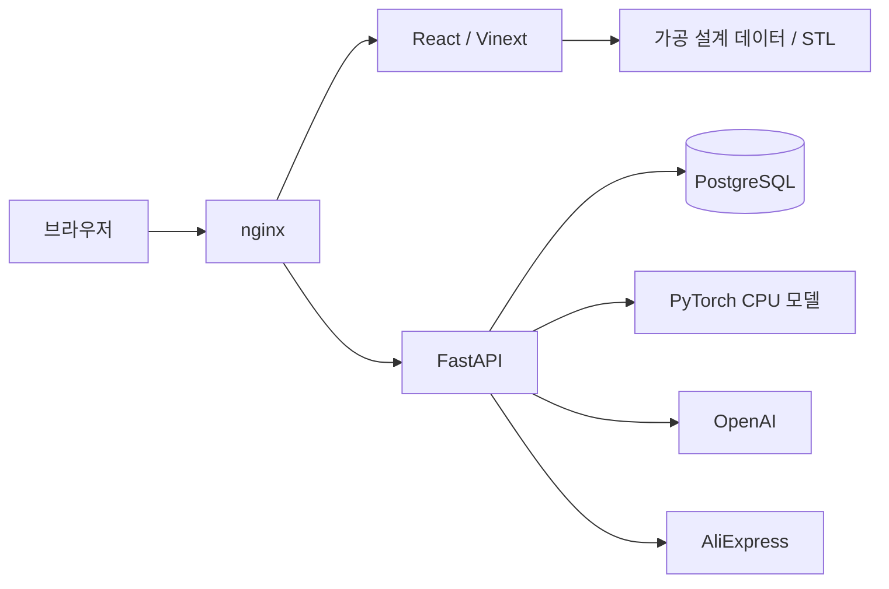

# Drawn

**드론 설계를 고르고, 바꾸고, 비교하는 웹 기반 UAV 설계 워크벤치.**

드론을 설계할 때는 기체의 형상, 부품 구성, 비행 성능을 함께 살펴봐야 합니다. 하지만 설계 파일과 시뮬레이션 결과가 서로 떨어져 있으면, 어떤 선택이 어떤 성능과 연결되는지 이해하기 어렵습니다.

우리는 이 정보를 하나의 작업 공간에서 다룰 수 있도록 Drawn을 만들었습니다. AircraftVerse의 **27,714개 설계와 시뮬레이션 결과**를 출발점으로, 설계 탐색 → 파라미터 편집 → 성능 확인 → 비교 → 부품 견적을 연결합니다. 현재는 데이터에 근거해 설계 대안을 탐색하는 MVP이며, 편집한 기체의 실제 성능 검증은 후속 과제입니다.

## 소개 영상

[](https://www.youtube.com/watch?v=Ies5ZSquPdg)

[YouTube에서 소개 영상 보기](https://www.youtube.com/watch?v=Ies5ZSquPdg)

## 무엇을 할 수 있나요?

| 기능 | 사용자가 할 수 있는 일 |
| --- | --- |
| **Design Explorer** | 설계 ID와 토폴로지로 기체를 찾고, 목표·제약 조건에 맞는 후보를 비교합니다. 후보 검색은 원본 성능 데이터와 Pareto front를 사용합니다. |
| **Design Studio** | 동체, 날개, 팔, 추진계, 배터리와 배치를 편집하고 파라메트릭 3D 형상으로 확인합니다. 원본 설계당 27–225개 변수를 보존합니다. |
| **Performance Simulator** | 속도별 성능 곡선을 읽고, 대표 설계의 피치 자세와 항력·양력·추력 벡터를 확인합니다. |
| **A/B Compare** | 기준 설계와 편집본, 또는 서로 다른 데이터셋 설계의 형상·구성·성능을 나란히 비교합니다. |
| **설계 도우미 AI** | 현재 프로젝트를 바탕으로 성능을 질문하고, 제한된 변경안을 검토하거나 BOM 기반 부품 후보와 견적을 정리합니다. 변경안은 사용자가 적용해야 반영됩니다. |
| **공유 갤러리** | 설계를 게시하고 다른 사람의 설계를 복사해 새로운 편집의 출발점으로 사용합니다. |
| **비행 장소 지도** | 국토교통부 초경량비행장치 비행공역 34곳을 지도에서 확인합니다. |

27,714개 설계에는 파라메트릭 개념 형상을 제공하며, **대표 12개 설계에는 원본 STL과 저장된 trim 곡선**을 함께 제공합니다. 파라메트릭 프리뷰와 원본 CAD 형상은 표현 방식과 정밀도가 다릅니다.

## 설계와 성능을 연결하는 방법

Drawn에는 서로 다른 계산 경로가 있습니다. 화면에 숫자가 표시되더라도 그 숫자의 출처와 적용 범위를 함께 읽어야 합니다.

| 경로 | 근거와 역할 | 해석 범위 |
| --- | --- | --- |
| **원본 시뮬레이션** | AircraftVerse의 `output.json`과 저장된 trim 결과 | 데이터셋에 포함된 기준 설계의 시뮬레이션 결과입니다. |
| **Neighbor Estimate v1** | 가까운 설계 5개의 KPI와 경험적 보정 | 편집 설계의 요약 KPI를 추정합니다. similarity는 정확도나 비행 성공 확률이 아닙니다. |
| **로컬 성능 모델** | PyTorch MLP의 속도별 추론 | 기준 설계의 성능 앵커에 조건화된 예측입니다. |
| **대화형 에이전트** | OpenAI의 목표 해석과 서버 도구가 반환한 근거 | 계산·조회 결과를 설명하고 허용된 작업을 제안합니다. |

로컬 모델은 `274 → 256 → 256 → 128 → 8` 구조의 MLP로, **항력, 양력, 추력, 피치, 전력, 전류, 비행시간, 거리**를 예측합니다. 원본 호버와 가능한 경우 20 m/s 시뮬레이션 값을 입력 앵커로 사용하며, 학습 속도 범위는 0–49 m/s입니다.

기체를 편집해도 이 앵커는 기준 설계의 값으로 유지됩니다. 따라서 예측값이 달라졌다는 사실만으로 실제 기체의 성능 변화가 검증되었다고 볼 수는 없습니다. 질량·최대속도·비행 유효성은 이 모델의 출력에 포함되지 않으며, 모델이 사용하지 않는 편집 항목도 별도로 표시합니다.

입력 계약, 평가 수치와 재현 범위는 [AI 모델 한계와 개선 과제](docs/AI_MODEL_LIMITATIONS.md), 요약 추정기의 동작은 [Neighbor Estimate 모델 카드](docs/MODEL_CARD.md)에 정리했습니다. 로컬 성능 추론에는 OpenAI 키나 잔액이 필요하지 않습니다.

## 시스템 구조



Docker 실행에서는 nginx가 화면과 API를 같은 origin으로 연결합니다. 프런트엔드 개발 서버를 별도로 실행할 때는 Vinext의 API 프록시가 FastAPI로 요청을 전달합니다.

| 영역 | 기술 |
| --- | --- |
| 화면과 상태 | React 19, TypeScript, Vinext, Tailwind CSS |
| 3D와 시각화 | Three.js, Recharts, Leaflet |
| API와 추론 | FastAPI, PyTorch CPU, NumPy |
| 저장소와 마이그레이션 | PostgreSQL 16, SQLAlchemy, Alembic |
| 실행 환경 | Docker Compose, nginx |

구현에서 중요하게 다룬 선택은 다음과 같습니다.

- **필요한 설계만 읽습니다.** 전체 메타데이터는 compact index로 제공하고, 설계 트리와 원본 파라미터는 29개 shard로 나누어 선택한 설계를 지연 로드합니다. 대규모 원본 데이터를 브라우저에 모두 올리지 않습니다.
- **편집과 근거를 함께 유지합니다.** 기준 설계, 편집본, 원본 변수와 성능 출처를 연결해 비교할 수 있도록 구성했습니다. 저장된 모델 번들은 시작 시 파일 해시와 검증 예측을 검사하며, 검증에 실패하면 추론을 비활성화합니다.
- **공유 상태는 서버가 관리합니다.** 개인 프로젝트, revision, 실행 기록과 견적은 PostgreSQL에 저장합니다. 변경안 적용은 소유권과 revision을 검사하고, 에이전트 진행 상황은 NDJSON으로 전달합니다.

현재 API 구현은 `backend/app/`입니다. `lib/agent/server/`, `lib/parts/server/`, `drizzle/`에는 이전 TypeScript·D1 구현과 이식 대조를 위한 참조 코드가 남아 있습니다. 자세한 실행 경로는 [구조 안내](docs/ARCHITECTURE.md)를 참고하세요.

## 시작하기

### 실행 환경

- Docker Engine 또는 Docker Desktop과 Docker Compose
- 초기 설정 스크립트를 실행할 Node.js 22.15 이상
- 별도 로컬 개발 시 Python 3.13과 PostgreSQL 16

**현재 clean install과 Linux CPU 모델 검증에는 아래에 기록한 재현성 문제가 있습니다.** 다음은 저장소가 지원하는 실행 구성입니다. 설치나 readiness 확인에 실패하면 [현재 상태와 남은 작업](#현재-상태와-남은-작업)을 먼저 확인하세요.

```bash
git clone --branch main https://github.com/gisedengdeung/drawn.git
cd drawn

# 기존 설정을 보존하고 로컬 설정 파일을 생성합니다.
node scripts/init-local-env.mjs

# 필요한 외부 서비스 키를 .env.local에 설정한 뒤 실행합니다.
docker compose --env-file .env.docker.local up -d --build
```

앱 주소는 `http://localhost:3000`, API 문서는 `http://localhost:3000/api/docs`입니다. Windows + Ubuntu WSL에서는 `scripts/start-docker.ps1`을 사용할 수 있습니다.

앱 실행에는 Git에 포함된 `public/data`, `public/models`, `backend/model_bundle`을 사용합니다. **원본 AircraftVerse 데이터 다운로드나 모델 재학습은 필요하지 않습니다.** 원본 데이터가 있을 때만 `npm run data:prepare`로 웹 자산을 다시 생성하세요.

### 외부 서비스 설정

`.env.example`을 기준으로 서버 설정을 준비합니다. 비밀값은 `.env.local` 등 Git에서 제외된 로컬 파일에 보관하며, 브라우저에 공개되는 환경변수 접두사를 사용하지 않습니다.

| 기능 | 필요한 설정 |
| --- | --- |
| 로컬 저장소와 세션 | `DATABASE_URL`, `SESSION_SECRET`, `APP_BASE_URL` — Docker 실행에서는 생성된 로컬 설정과 Compose를 사용합니다. |
| Google 로그인과 개인 프로젝트 | `GOOGLE_CLIENT_ID`, `GOOGLE_CLIENT_SECRET`, 등록된 OAuth callback |
| 대화형 설계 도우미 | `OPENAI_API_KEY`, 이용 가능한 API 프로젝트 |
| 실제 부품 조회 | `ALIEXPRESS_APP_KEY`, `ALIEXPRESS_APP_SECRET` 및 해당 API 권한. 제휴 링크 생성에는 `ALIEXPRESS_TRACKING_ID`도 사용합니다. |
| 별도 프런트 개발 서버 | `API_INTERNAL_URL` — 기본값은 `http://127.0.0.1:8000`입니다. |

기본 화면과 공개 데이터 탐색에는 외부 API 키가 필요하지 않습니다. Google 로그인 callback은 `APP_BASE_URL/api/auth/callback/google`로 등록하며, 프런트와 FastAPI의 origin 설정을 맞춰야 합니다.

Python 가상환경, 마이그레이션, 별도 개발 서버 실행과 기존 D1 데이터 이전은 [FastAPI 실행 안내](docs/FASTAPI_MIGRATION.md)에 정리했습니다. `npm run dev`는 FastAPI와 DB의 준비 상태를 먼저 확인하므로 백엔드를 먼저 실행해야 합니다.

## 검증

프런트엔드와 데이터 검증은 저장소 루트에서 실행합니다.

```bash
npm test
npm run typecheck
npm run build
npm run data:validate
```

백엔드 의존성은 `backend/requirements-dev.txt`에 있습니다. 해당 의존성을 설치한 Python 환경에서 다음 검사를 실행합니다.

```bash
# TEST_DATABASE_URL은 별도로 만든 PostgreSQL 테스트 DB를 가리켜야 합니다.
# 이 변수가 없으면 PostgreSQL 통합 테스트 일부가 skip됩니다.
python -m pytest backend/tests

# 원본·번들 해시와 CPU 검증 예측을 검사합니다. 파일을 재생성하지 않습니다.
python scripts/package-performance-model.py --verify-only

# 실행 중인 API에서 실제 모델 준비 상태와 예측을 확인합니다.
npm run model:check
```

`/api/health/live`는 API 응답 여부를, `/api/health/ready`는 DB와 검증된 모델의 준비 상태를 확인합니다. 이 결과만으로 실제 Google 로그인이나 외부 공급자 호출 성공까지 확인할 수는 없습니다.

## 현재 상태와 남은 작업

핵심 화면, 데이터 탐색, 파라미터 편집, 비교, 서버 저장과 에이전트 실행 구조를 구현했습니다. 실제 외부 계정을 연결한 전체 사용자 흐름과 편집 설계의 예측 품질은 추가 검증이 필요합니다.

2026-10-12 클라우드 환경 점검에서는 프런트엔드 빌드·타입 검사, JavaScript 테스트 173개와 가공 데이터 검증을 통과했습니다. PostgreSQL 마이그레이션, 화면 렌더링과 공개 갤러리 API 프록시도 확인했습니다. 다음 문제는 아직 남아 있습니다.

- **설치 재현성:** 현재 `package-lock.json`에는 일부 선택적 WASM 의존성 항목이 누락되어 있어 `npm ci`가 실패합니다. 환경 점검에서는 저장소 밖의 설치용 사본을 보완하고, 기존 고정 버전과 integrity 값이 유지되는지 확인해 의존성을 설치했습니다. 저장소 lockfile의 수정은 후속 작업입니다.
- **CPU 모델 호환성:** Linux CPU의 `torch==2.13.0+cpu`에서 파일 해시는 일치했지만, golden 출력 160개 중 2개가 고정된 수치 허용 오차를 넘었습니다. 모델은 검증 실패 시 추론을 차단합니다. 이로 인해 백엔드 테스트는 84개 통과, 2개 실패, 14개 setup error였으며 모델 관련 검사 전체 통과를 주장하지 않습니다.
- **실제 사용자 흐름:** Google 로그인부터 정상 OpenAI 응답, 변경안 적용, 부품 견적 저장까지 연결한 외부 서비스 통합 검증이 남아 있습니다. mock을 사용한 테스트와 실계정 검증을 구분합니다.
- **편집 설계의 평가:** 수정 전후 설계를 같은 조건으로 시뮬레이션하고, 보지 못한 설계·부품·변경 범위에서 오차를 평가해야 합니다. 현재의 조건부 예측을 형상만으로 성능을 계산하는 모델로 확대 해석하지 않습니다.

상세 완료 기준은 [에이전트 완성도와 남은 작업](docs/AGENT_READINESS.md), 모델 개선 방향은 [AI 모델 한계와 개선 과제](docs/AI_MODEL_LIMITATIONS.md)에 있습니다.

Drawn의 프리뷰와 예측은 설계 탐색을 위한 자료입니다. 제작 안전성, 실제 비행 가능성이나 비행 인증을 보증하지 않습니다. 비행 장소 지도 역시 연간 공역 스냅샷이므로 실제 비행 전에는 [드론 원스톱](https://drone.onestop.go.kr)에서 최신 제한을 확인해야 합니다.

## 팀원과 역할

GitHub 기여 이력을 기준으로 정리한 각 팀원의 주요 작업 영역입니다.

| 팀원 | 주요 역할 | 기여 내용 |
| --- | --- | --- |
| [barcybarcy](https://github.com/barcybarcy) | 데이터·에이전트·서비스 통합 | AircraftVerse 데이터 통합, 파라메트릭 설계 스튜디오, 설계·부품 에이전트, FastAPI 연동과 실행 구조 통합 |
| [combo124](https://github.com/combo124) | 3D 형상·파라미터 편집·프런트엔드 | 파라메트릭 기체 형상과 편집 기능, STEP 부품 좌표 추출, 설계·탐색 화면 개선 |
| 이동현 · [ldh0784](https://github.com/ldh0784) | 사용자 경험·설계 탐색·비행 지도 | 설계 비교와 후보 탐색, 비행 공역 지도, 즐겨찾기와 정밀 입력, 화면 사용성 개선 |
| [EastHA2403](https://github.com/EastHA2403) | 성능 모델·학습 데이터 | XGBoost 성능 예측 데이터 파이프라인, 딥러닝 학습용 trim 물리량 데이터 확장 |
| [kmj8575](https://github.com/kmj8575) | 기체 외관·스킨 편집 | 드론 스킨 선택, 외관 미리보기, 스킨 파라미터 UI |
| [jaypower199](https://github.com/jaypower199) | 설계 공유·상품 화면·브랜딩 | 설계 공유와 갤러리, 패키지 상품 페이지, 프로젝트 로고 |

## 저장소 둘러보기

```text
app/                    페이지와 FastAPI 프록시 라우트
components/, hooks/     화면, 3D 뷰어, 클라이언트 상태
lib/                    설계·성능·부품 도메인과 공용 타입
backend/app/            인증, 프로젝트, 에이전트, 부품 API, 성능 추론
backend/alembic/        PostgreSQL 마이그레이션
backend/model_bundle/   실행용 가중치, 전처리, manifest, 검증 샘플
public/data/            가공 설계 데이터와 카탈로그
public/models/          대표 설계 STL
ml/                     학습 자료와 원본 실험 산출물
scripts/                데이터 가공, 실행 준비, 모델 패키징과 진단
infra/, compose.yaml    nginx와 Docker 서비스 구성
tests/, backend/tests/  프런트 계약·참조 구현·백엔드 테스트
docs/                   구조, 모델 경계, 데이터와 실행 안내
```

데이터 원본과 배포 자산의 구분은 [데이터 배치 안내](docs/DATA_LAYOUT.md), 학습 자료와 체크포인트의 출처는 [ML 안내](ml/README.md), 부품 조회·견적의 계약은 [부품 에이전트 안내](docs/PARTS_AGENT.md)를 참고하세요.
