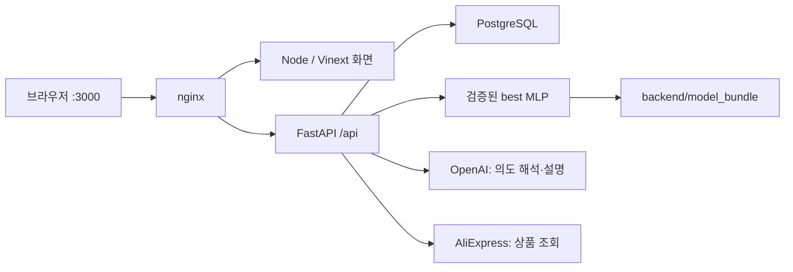

# 실행 구조와 모델 파일

현재 API 업무 처리는 FastAPI가 담당합니다. 설계 편집·원본 데이터 탐색, 학습 모델의 성능 예측, OpenAI의 대화형 에이전트는 서로 다른 실행 경로입니다.

현재 지원 범위와 미완료 항목은 [AI 모델 한계](AI_MODEL_LIMITATIONS.md)와 [에이전트 완성도](AGENT_READINESS.md)를 참고하세요.



## 소스 위치

| 위치 | 역할 |
| --- | --- |
| `app/`, `components/`, `hooks/` | 페이지, 화면, 클라이언트 상태 |
| `lib/agent/`, `lib/parts/`의 클라이언트·도메인 파일 | 프런트 설계·견적 타입 및 계산 |
| `backend/app/` | 현재 API, 인증, 프로젝트·견적·에이전트, 성능 모델 |
| `backend/alembic/` | 현재 PostgreSQL 스키마 이력 |
| `backend/model_bundle/` | 배포·추론용 가중치, 전처리 JSON, 검증 샘플 |
| `ml/sources/dongha/` | 받은 학습 코드·데이터·원본 run 보존 |
| `ml/archive/root-artifacts/` | 루트에 따로 놓였던 체크포인트·전처리 파일 보존 |
| `ml/data/`, `ml/runs/` | 기존 PointNet 데이터와 실험 |
| `public/data/` | 앱이 읽는 가공 설계 데이터 |
| `data/raw/` | 로컬 원본 AircraftVerse 데이터 |
| `scripts/` | 실행·가공·모델 배포·진단 명령 |
| `infra/`, `compose.yaml` | nginx와 Docker 서비스 연결 |

모델 원본과 파일 이동 검증은 [ML 안내](../ml/README.md), 배포 모델의 입력·출력 계약은 [번들 안내](../backend/model_bundle/README.md)를 따릅니다. 원본 `best_model.pt`에서 내보낸 동일한 가중치를 `weights.npz`로 읽습니다. 실행 중 모델은 별도 체크포인트를 다시 학습하거나 원본 pickle을 역직렬화하지 않습니다.

## 성능 정보의 출처

| 화면의 정보 | 계산 출처 | OpenAI 잔액 필요 |
| --- | --- | --- |
| 원본 KPI·trim 곡선 | AircraftVerse 시뮬레이션 데이터 | 아니요 |
| 편집 후 요약 KPI | Neighbor Estimate v1 | 아니요 |
| 학습 모델의 속도별 8개 예측 | FastAPI의 best MLP | 아니요 |
| 설계 도우미의 의도 해석·답변 | OpenAI API | 예, 무료 토큰도 양수 잔액 조건이 있음 |

best MLP는 항력·양력·추력·피치·전력·전류·비행시간·거리를 예측합니다. 질량·최대속도·비행 유효성은 예측하지 않으며, 원본 호버·20m/s 시뮬레이션 입력에 조건화됩니다. 모델이 사용하지 않는 편집값은 예측값을 바꾸지 않고 화면에 미반영 항목으로 표시합니다.

무료 토큰의 잔액·대상 프로젝트 조건: [OpenAI 공식 안내](https://help.openai.com/en/articles/10306912-sharing-feedback-evals-and-api-data-with-openai).

## 활성 코드와 이전 구현

`app/api/`와 `lib/server/api-proxy.ts`는 Node 개발·단독 실행 시 FastAPI에 전달하는 계층입니다. Docker에서는 nginx가 API를 FastAPI로 직접 전달합니다.

`lib/agent/server/`, `lib/parts/server/`의 이전 TypeScript 서버는 현재 API 실행 경로에 포함되지 않습니다. 기존 동작의 회귀·Python 이식 대조를 위한 참조 코드로 유지합니다. `drizzle/`와 `lib/db/schema.ts` 역시 이전 D1 구조를 기록하며 현재 DB는 Alembic으로 관리합니다. 기존 참조 테스트가 이 경로를 직접 불러오므로 이름만 일괄 변경하지 않습니다.

JavaScript 테스트에는 현재 프런트 계약과 이전 서버 참조 테스트가 함께 있고, 실제 Python 서비스 검증은 `backend/tests/`가 담당합니다. 실제 PostgreSQL 테스트는 별도 `TEST_DATABASE_URL`이 필요합니다. 이전 학습 코드에 관한 테스트의 재현 한계는 [ML 안내](../ml/README.md)에 별도 기록합니다.

## 로컬에서 추론 확인

```bash
npm run model:check
```

기본 `http://localhost:3000`에 모델 준비 상태와 실제 추론을 요청합니다. 로그인·OpenAI 호출은 사용하지 않습니다. 다른 서버는 `npm run model:check -- --base-url http://localhost:5173`으로 검사합니다. 연결·모델 실행 점검이며 실측 비행 성능의 정확도를 보증하는 평가는 아닙니다.

화면에서는 설계 #17297을 고른 뒤 설계 편집 또는 시뮬레이터의 학습 모델 패널을 확인합니다. 지원되는 동체 길이를 변경하면 속도별 예측이 다시 계산됩니다. 원본 입력이 없는 설계는 명시적인 오류가 표시됩니다.

실행 모드와 환경변수는 [FastAPI 실행 안내](FASTAPI_MIGRATION.md)를 따릅니다.
